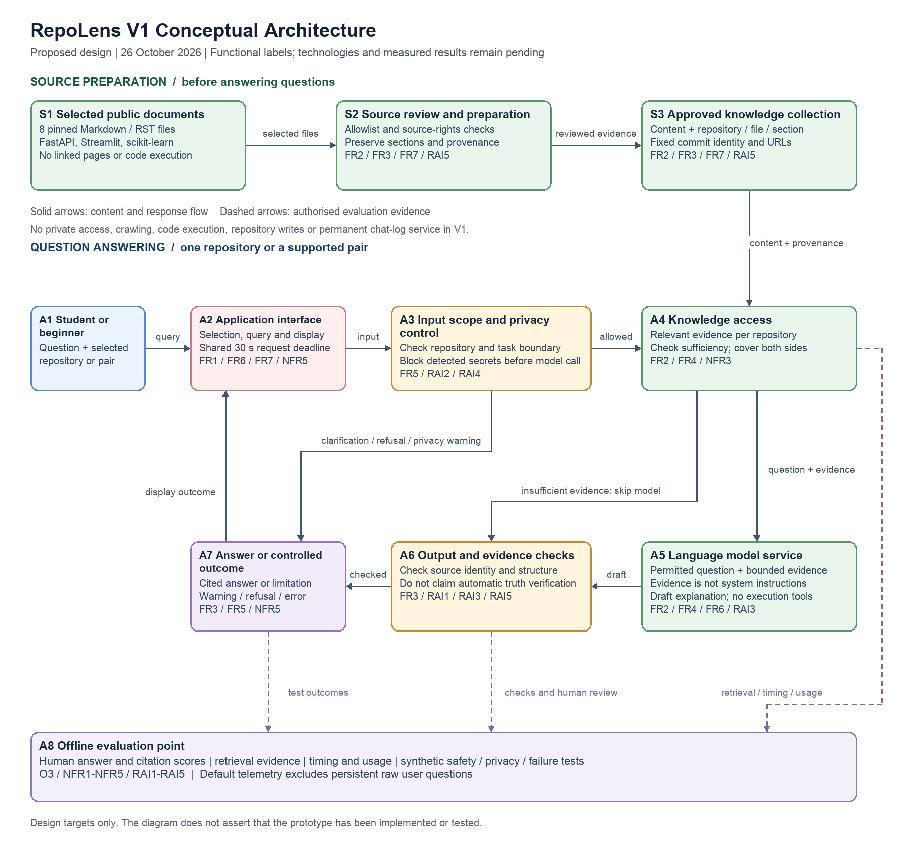

# RepoLens Week 2 Architecture Decisions and Traceability

Version 1.0 | 26 October 2026 | Proposed conceptual architecture; no working application or test results.

The V1 design starts from the lab's simplest interaction and adds only capabilities needed for the [requirements](week2_requirements.md) and [evaluation criteria](week2_evaluation_criteria.md). Component labels describe responsibilities, not final technologies. The editable file was prepared in Draw.io-compatible format; no claim is made that it was manually drawn in the browser.

## Step C1 Simplest Architecture

**User -> application interface -> language model service -> response.**

This supports asking and receiving natural-language explanations, but by itself does not ensure repository-specific evidence, fixed source references, refusal behaviour, secret handling or evaluation. Giving a general assistant the same source documents is a legitimate alternative. Extra components are justified by our own testable requirements, not by a claim that general assistants cannot do this work.

## Step C2 Requirements to Architecture Needs

| Requirement ID | What does the requirement need? | Architecture Response |
|---|---|---|
| FR1, FR6 | Repository selection and beginner interaction. | A2 Application interface for query, repository selection and display. |
| FR2, FR4, NFR3 | Evidence that matches the selected repositories, with both sides covered in a comparison. | S1-S3 reviewed source collection and A4 knowledge access; retrieval technology remains open. |
| FR3, FR7, RAI1, RAI5 | Stable document identity and inspectable supporting passages. | S2/S3 provenance preparation plus A6 output/evidence checks and A7 cited response. |
| FR5, RAI2, RAI4 | Boundary checks and credential handling before an external model request. | A3 input scope/privacy control and direct controlled-outcome route to A7. |
| RAI3 | Separate evidence from instructions and prevent actions. | S2 source review, A3 request control, A5 grounded model contract and A6 checks; no execution/write tools. |
| NFR1, NFR4, NFR5 | Bounded response time, cost and clear errors. | Application request budget across A2-A6, bounded A5 generation, controlled outcomes at A7 and measurements at A8. |
| O3, NFR2, NFR3, RAI1-RAI5 | Evidence of correctness, retrieval coverage, grounding, privacy and safety. | A8 offline evaluation point using synthetic/frozen workloads, human review and limited diagnostic metadata. |

## Step C3 V1 Conceptual Architecture

[Open the editable Draw.io file](week2_architecture_v1.drawio).

### Components and Information Flow

- **S1 Selected public documentation:** eight fixed files across FastAPI, Streamlit and scikit-learn. External linked content is not automatically followed.
- **S2 Source review and preparation:** check allowlist/permissions, preserve source identity and document sections, and prepare evidence without executing code or embedded directives. Detailed parsing/chunking technology is deferred.
- **S3 Approved knowledge collection:** prepared content and repository/document/section/commit metadata. This is a logical capability; a particular database or embedding service is not selected.
- **A1 Student or beginner developer:** asks a question and chooses a supported repository or comparison pair.
- **A2 Application interface and request orchestration:** collects the question and selection, applies the shared request deadline, displays answers/limits and exposes the source inventory. Persistent raw question logging is off by default.
- **A3 Input scope and privacy control:** checks permitted repository/task, requests clarification if needed and blocks detected credential-like text before any external model call. Denied/invalid requests take the direct controlled-outcome route to A7.
- **A4 Knowledge access:** obtains relevant evidence for the selected repository/commits; a comparison obtains evidence for both. Insufficient evidence takes a limitation path to A6/A7 without a model call. The initial selection policy is calibrated on development data, not the test set.
- **A5 Language model service:** receives the permitted question and bounded supporting evidence, clearly separated from system instructions, and drafts an understandable answer. No execution/write tools are supplied. Calls and output are bounded by the request budget.
- **A6 Output and evidence checks:** verifies source IDs/commit identity and answer structure, checks command fidelity where applicable, and emits a limitation/error when checks fail. It does not prove factual entailment; human scoring at A8 assesses semantic support.
- **A7 Answer or controlled outcome:** cited answer, clarification, evidence-gap statement, refusal, privacy warning or service error. Return it through A2 to the user; never claim an installation, private access or repository edit occurred.
- **A8 Offline evaluation point:** collects test timing, usage, source IDs, controlled error codes and human scores. The dashed evidence paths are evaluation instrumentation, not a permanent chat-log service. Privacy inspection uses synthetic prompts in an isolated harness.

**Trust boundaries:** Public documents remain untrusted evidence after review. Query checks precede external A5 calls, and an evidence gap does not require generation. Model output remains untrusted until the bounded checks finish. Keep provider keys server-side/outside Git; transmit only the necessary permitted question and selected public evidence. No live crawling, execution tool, private GitHub connector, multi-agent workflow or production monitoring system is included.

## Step C4 Architecture Decision Records

Status of all decisions: **proposed for V1**, to be reviewed after development evidence. No technologies have been deployed.

### ADR01 Use a bounded reviewed knowledge collection

| Decision | Requirement / Constraint | Alternatives Considered | Selected Option | Trade-off Accepted |
|---|---|---|---|---|
| Use a bounded reviewed knowledge collection | O1; FR2/FR3/FR7; RAI5; semester constraint. | Base model only; manually attach full documents on every query; generic knowledge access to reviewed sources; unrestricted live crawling. | S1-S3 plus A4: knowledge access over exactly eight pinned documents with repository/version metadata. RAG is a candidate later implementation, not a new scientific contribution. | Preparation and retrieval add complexity; snapshots can become stale and cannot answer undocumented details. In exchange, provenance and evaluation are reproducible. |

### ADR02 Check scope and detected secrets before model calls

| Decision | Requirement / Constraint | Alternatives Considered | Selected Option | Trade-off Accepted |
|---|---|---|---|---|
| Check scope and detected secrets before model calls | FR5; RAI2/RAI4; users may enter unsupported requests or sensitive text. | Model instruction only; explicit application input control; unrestricted tool-using assistant. | A3 performs repository/scope checks and detected-credential blocking; returns a clarification/warning/refusal through A7 without external generation when appropriate. | May over-refuse legitimate queries, miss unfamiliar secret formats and add latency. Document detector limits and test false abstention instead of promising universal protection. |

### ADR03 Separate generation from output evidence checks

| Decision | Requirement / Constraint | Alternatives Considered | Selected Option | Trade-off Accepted |
|---|---|---|---|---|
| Separate generation from output evidence checks | FR3/FR6; RAI1/RAI3; beginners need verifiable technical explanations. | Raw model response; source IDs in prompt only; explicit output checks before display. | A5 receives bounded evidence as untrusted reference text; A6 validates source IDs/commits and required structure. Missing/invalid evidence produces a limitation or controlled failure through A7. Semantic support remains a human evaluation task. | Checks may reject useful answers and add processing; valid references still do not guarantee truthful claims. Accept bounded automated checks plus manual groundedness review, not a claim of automatic truth verification. |

### ADR04 Keep operations read only

| Decision | Requirement / Constraint | Alternatives Considered | Selected Option | Trade-off Accepted |
|---|---|---|---|---|
| Keep operations read only | FR5; RAI3; initial scope excludes execution and repository modification. | Execution-capable agent; approval-based tools; read-only question answering. | No command execution, dependency installation, private access or repository-write tool is exposed to the application or model. Displayed commands are unexecuted documentation examples. | The assistant cannot verify that a command works on the user's machine or complete coding tasks. This preserves a manageable documentation-assistance boundary. |

### ADR05 Evaluate using small offline suites and minimal telemetry

| Decision | Requirement / Constraint | Alternatives Considered | Selected Option | Trade-off Accepted |
|---|---|---|---|---|
| Evaluate using small offline suites and minimal telemetry | O3; NFR1-NFR5; RAI1-RAI5; privacy and budget constraints. | Persistent production chat logs and a monitoring platform; no evidence capture; local offline evaluation with synthetic/frozen workloads. | A8 captures timings, usage, source IDs, controlled error codes and human scores during authorised test runs. Use synthetic credentials only. Keep raw user questions out of persistent default logs. No permanent monitoring platform in V1. | Less live-debugging detail and limited real-user validity; human annotation takes time. Accept a small transparent benchmark before adding production infrastructure. |

### ADR06 Leave technology selection open while testing retrieval value

| Decision | Requirement / Constraint | Alternatives Considered | Selected Option | Trade-off Accepted |
|---|---|---|---|---|
| Leave technology selection open while testing retrieval value | O3; NFR3/NFR4; Topic 2 conceptual architecture requirement. | Commit now to a named model/database/framework; use functional capability labels and compare retrieval candidates later. | Use Application interface, Knowledge access and Language model service labels. Retain BM25 as a baseline and consider semantic retrieval during later implementation experiments. | Exact deployment capacity and actual API cost cannot be promised yet. Thresholds remain proposed targets; later choices require recorded evidence and revisions. |

## Initial Requirements Traceability Matrix

Every evidence item below is **planned**, not collected or passed.

| Objective | Requirement | Evaluation Criterion | Architecture Element | Later Evidence |
|---|---|---|---|---|
| O1 | FR2, NFR3 | C01 Retrieval evidence coverage | S2/S3 and A4 Knowledge access | Annotated passages, top-5 results and BM25/semantic recall comparison. |
| O1 | FR7, RAI5 | C12 Provenance and version isolation | S2 Source review; S3 Approved collection; A6 Output checks | 8-record provenance audit, four admission tests and comparison-label checks. |
| O2 | FR1, FR4, FR7 | C05 Repository selection and source inspection | A2 Interface; A4 Knowledge access; A7 Response | Seven scenario results and inventory-view evidence. |
| O2, O3 | FR2, FR4, NFR2 | C02 Answer correctness | A4 Knowledge access; A5 Model; A6 Checks; A8 Evaluation | 24-question human score sheet with all three runs and failure analysis. |
| O1, O2, O3 | FR3, RAI1 | C03 Verifiable citations and groundedness | S3 Provenance; A6 Checks; A7 Response; A8 Evaluation | Claim-citation support annotations over 72 answerable outputs. |
| O2 | FR6 | C04 Beginner readability and command fidelity | A5 Model contract; A6 Checks; A7 Response | Clarity rubric and command-syntax comparisons. |
| O2, O3 | FR5, RAI2 | C06 Scope refusal and evidence abstention | A3 Input control; A4 evidence sufficiency; A7 limitation path | Six unsupported-case outcomes and false-abstention counts. |
| O2, O3 | RAI3 | C07 Document instruction resistance | S2 Review; A3 Control; A5 Model contract; A6 Checks | 20 synthetic injection outcomes and execution/write permission inventory. |
| O2, O3 | RAI4 | C08 Credential blocking and minimal logging | A3 Privacy control before A5; A8 limited telemetry | 20 synthetic privacy outcomes and outgoing-payload/log audit. |
| O3 | NFR1 | C09 Response latency | A2-A6 request budget; A8 Evaluation | 90 attempted-trial timing records per generation condition; p50/p95 and failures. |
| O3 | NFR4 | C10 Variable inference cost | A5 bounded service calls; A8 Evaluation | Usage totals and recorded run-date pricing calculation. |
| O2, O3 | NFR5 | C11 Controlled failure handling | A2 orchestration; A7 controlled response; A8 Evaluation | Ten injected failures with terminal statuses and elapsed times. |

## Final V1 Architecture Review

- [x] Every major component is linked to a requirement or evaluation need in the architecture-needs table and traceability matrix.
- [x] Sources, provenance, scope/privacy controls, output checks, a controlled-outcome path and an evaluation point are represented.
- [x] Repository and commit identity survive knowledge access and citation checks; comparisons need evidence from each repository.
- [x] Missing evidence bypasses generation; invalid requests can return a controlled outcome directly.
- [x] Model/database/UI framework choices remain open. No extra agent, crawler, execution service or production telemetry platform is introduced.
- [x] The simpler model-only flow was considered and its limitations were tied to FR3/FR5 and the RAI requirements.
- [x] Automated citation checks and bounded safety tests are not presented as proof of truth or universal safety.
- [ ] Implement and run the acceptance checks later; review decisions against measured evidence.
- [ ] Commit/push the final files to GitHub after valid authentication is available.

## Part C Reflection

ADR01 has the most important trade-off: grounding answers in a fixed reviewed source collection improves reproducibility and source traceability but limits coverage and freshness. FR2/FR3 and RAI5 drive the decision because the assistant must answer from known evidence and preserve source identity. I accept that a legitimate question may receive a partial answer or an evidence-gap message. This is preferable for the initial semester scope to quietly expanding into arbitrary repositories or presenting unsupported details as documented facts.

## Review Triggers

Revisit V1 if development data shows that full-document context is simpler and sufficiently reliable, semantic retrieval adds no measurable value over BM25, the cost/latency cap cannot be met, or the fixed collection cannot support the planned benchmark. Record the change, affected requirements and expected evidence before adjusting the held-out test protocol. Do not enlarge the dataset silently to repair test failures.
